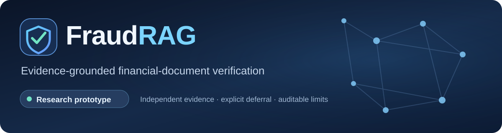
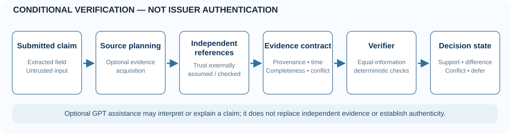

<p align="center">
  
</p>

<h3 align="center">A financial document can balance perfectly and still disagree with its reference evidence.</h3>

<p align="center">
  FraudRAG is an open research prototype for document-consistency checks, conditional evidence verification, and transparent abstention. It compares extracted claims with separately obtained reference information—without treating an LLM prediction as proof of authenticity.
</p>

<p align="center">
  <a href="https://github.com/akshaysharma1088/fraudrag/actions/workflows/ci-cd.yml"></a>
  <a href="https://doi.org/10.5281/zenodo.23679156"></a>
  <a href="research/publication/README.md"></a>
  <a href="research/publication/SUBMISSION_GATE.md"></a>
</p>

<p align="center">
  <a href="docs/index.html"><b>Project website source</b></a> ·
  <a href="research/publication/README.md"><b>Evidence ledger</b></a> ·
  <a href="https://doi.org/10.5281/zenodo.23679156"><b>Zenodo record</b></a> ·
  <a href="https://github.com/akshaysharma1088/fraudrag/pull/1"><b>Experimental research branch</b></a>
</p>

---

## Why FraudRAG?

Document structure, formatting, and internal arithmetic are **not the same thing** as issuer-authenticated evidence. An altered amount can preserve an opening/closing balance identity; even a convincing language-model explanation does not establish which version of the document is true.

FraudRAG explores an explicit decision boundary:

| Conditional outcome | Interpretation |
|---|---|
| **Supported** | Sufficient eligible, independent reference evidence agrees with the claim. |
| **Different** | An eligible reference shows a mismatch in the compared field or value. |
| **Conflicting** | Admissible references disagree; do not silently select one. |
| **Defer** | Source evidence is missing, incomplete, stale, untrusted, or otherwise insufficient. |

**Important:** These are proposed research decision states conditioned on source-quality assumptions. They do **not** authenticate the issuer or prove criminal fraud.

## How it works

<p align="center">
  
</p>

1. **Extract claims** from a submitted document or question. These claims are treated as untrusted input.
2. **Plan evidence acquisition**, where relevant, within the available reference sources and research budget.
3. **Gather independent reference evidence.** In current experiments, trust/issuer attributes may be simulated; a real deployment would require external verification.
4. **Apply evidence contracts:** provenance, effective time, completeness, and consistency.
5. **Compare with deterministic controls** and optionally use GPT to interpret or explain supported observations; avoid unsupported authenticity conclusions.

The codebase explores Neo4j, ChromaDB, Python/FastAPI and a React interface. Including a component in the prototype does **not** mean that a multi-hop graph, real bank API, latency target, or product security benefit has been independently demonstrated.

## Results: what we actually measured

The linked experiment archives and independent checks matter more than a headline fraud-detection score.

| Study | Verifiable observation | Scope |
|---|---|---|
| **V2 — complete constructed ledger** | GPT with retrieved reference and equally informed deterministic reconciliation both obtained **F1 1.000** on 28 fictional cases. | Small, synthetic; **no accuracy advantage shown**. |
| **V3 — published synthetic PDFs** | 60 actual GPT calls on 20 controlled text changes from five publisher-generated synthetic document originals. | Extracted-text comparison, not document-image forgery detection. |
| **V4 — simulated evidence cost** | At an invented 4-unit budget, dynamic programming covered **70.69%** and prior-aware greedy **68.75%** of 720 synthetic test groups. | Paired CI includes zero; costs are not USD or live bank API expenses. |
| **V5 — financial-report evidence conditions** | 329 human-gold candidate spans from **187** TAT-QA contexts under synthetic witness, trust, time and conflict interventions. | Gold candidates supplied to deterministic matchers; not end-to-end QA. |
| **V6 — zero supplied evidence** | Ordinary and evidence-cautious GPT prompts both abstained **24/24** times. | No benefit of extra prompting established in this control. |
| **V7B — public financial QA** | Two GPT prompting policies answered 64/64 each on TAT-QA public test contexts; approximate token F1 **0.518 vs 0.534**. | Paired interval crosses zero; citation IDs alone do not prove support. |

Read the [complete evidence ledger](research/publication/README.md) for source identifiers, failed/incomplete pilots, study selection, raw-run links and limitations. The earlier V5 gold-string deletion pilot was **not** a valid unsupported-answer benchmark because semantically equivalent passages could remain.

> **Research-only:** We have not established validated real-bank-forgery detection, issuer attestation, production safety, or a statistically established advantage over full-information deterministic checking. Do not repeat older unverified AUC, F1, latency or IEEE publication claims.

## Quick start — local prototype

Use fictional data or documents you are authorized to process. The application is a research prototype, not a secure hosted financial-document verification service.

```bash
git clone https://github.com/akshaysharma1088/fraudrag.git
cd fraudrag
cp .env.example .env
# Review the configuration; add only credentials required by your chosen local provider.
docker compose up -d
```

The configured API documentation can be inspected at `http://localhost:8000/docs` after the local stack starts. You can also run the lightweight test environment:

```bash
python -m venv .venv
source .venv/bin/activate
pip install -r backend/requirements-ci.txt
python -m pytest tests/ -q
```

Experiments V2–V7B, data pins and reproducibility materials live on the separate [research branch](https://github.com/akshaysharma1088/fraudrag/tree/research/reproducibility-hardening-2026-10). They are **not part of the default production app** and some research workflows use external services or paid models. Do not launch research workflows unintentionally.

## Publication, archive and citation

**Zenodo DOI supplied by the maintainer:** [10.5281/zenodo.23679156](https://doi.org/10.5281/zenodo.23679156). The DOI URL is included for discoverability, but its public record metadata could not be independently retrieved during this README update. **Check that the title, creators, version, publication date and license on Zenodo match the material being cited** before using it in a paper.

The existing [SSRN FraudRAG preprint](https://doi.org/10.2139/ssrn.6714178) is a separate earlier work. An IEEE Open Journals-format article is currently an **author-review manuscript**, *not* a submitted, accepted or published IEEE article. The prior-preprint overlap/claims require author-controlled correction and disclosure.

Use [`CITATION.cff`](CITATION.cff) as repository-level citation metadata, subject to reconciliation with the Zenodo record. For the underlying finance QA data, cite the original [TAT-QA paper](https://doi.org/10.18653/v1/2021.acl-long.254) separately.

## Roadmap

- Independently validate reference provenance and issuer/source authenticity.
- Test source grouping and semantic support on additional, rights-cleared external datasets.
- Compare source-planning methods against equally informed deterministic baselines, including cost and abstention uncertainty.
- Obtain independent scientific review and complete employer, author, and prior-publication disclosures.

## Project status and licensing

**Status: experimental research prototype.** Application code, archived experimental artifacts, third-party source documents, and article text may have **different rights**. A definitive repository-wide license is not currently asserted; check the relevant file/source terms and contact the maintainer before reuse. Never submit genuine customer statements, account numbers, or private data to this demo without separate security, privacy and retention approval.

**Maintainer:** Akshay Sharma · [GitHub](https://github.com/akshaysharma1088) · [Project evidence ledger](research/publication/README.md)

---
*The goal is to understand when available evidence warrants a conclusion—and when it does not.*
